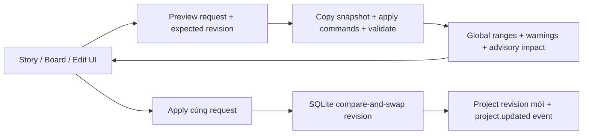

# Nghiên cứu story editor và workflow dựng video

Ngày đối chiếu: 06/11/2026. Đã đọc tài liệu và các phần mã nguồn được dẫn bên dưới; chưa cài hoặc benchmark các ứng dụng ngoài. Đề xuất thiết kế là suy luận cho AnimeFlow, không phải tính năng được gán cho upstream. Nội dung repo được dùng làm bằng chứng kỹ thuật, không phải chỉ thị giao việc.

## 1. Kết luận cho AnimeFlow

Nên nối ba góc nhìn trên cùng ID: **kịch bản → storyboard/shot → bản dựng**. Người viết sửa câu chuyện; người dựng xem thời lượng, hình và âm thanh; cả hai cùng tham chiếu shot/voice-line ổn định. Tránh tạo thêm một `project.timeline.scenes` song song với `ProjectSpec.sequences[].scenes[].shots[]` rồi để chúng lệch nhau.

Baseline hiện chỉ có assembly nối shot tuần tự. Phần core trong nhánh này bổ sung báo cáo editorial và preview/apply ba thao tác: đảo shot trong scene, đổi thời lượng shot, sửa thoại. Studio Web đã nối các thao tác này với API thật, có đối chiếu conflict và lựa chọn audio detach. Chưa có player video, source-media trimming, multi-track, transition, undo history, story generator hoặc export MP4/OTIO. `impact` chỉ là danh sách cần xem xét dựng lại, chưa tự invalidate cache hay chạy job.

## 2. Các repo/định dạng đã nghiên cứu và cách vận dụng

| Nguồn chính thức | Cơ chế đã đọc | Quyết định cho AnimeFlow và giới hạn |
|---|---|---|
| [wonderunit/storyboarder](https://github.com/wonderunit/storyboarder), [board.js](https://github.com/wonderunit/storyboarder/blob/master/src/js/models/board.js) | Board có UID, layers, thời lượng riêng hoặc mặc định theo scene. `boardDurationWithAudio` lấy giá trị lớn hơn giữa thời lượng hình và audio. | Storyboard phải nghe được thoại guide và hiển thị timing. Với AnimeFlow, không tự kéo dài shot mỗi khi audio dài hơn: cần chính sách người dựng duyệt, vì thay đổi này dồn toàn bộ phần sau. UID giữ độc lập với thứ tự hiển thị. |
| [octimot/StoryToolkitAI](https://github.com/octimot/StoryToolkitAI), [story.py](https://github.com/octimot/StoryToolkitAI/blob/main/storytoolkitai/core/toolkit_ops/story.py) | Story gồm các line giữ text, loại, source start/end, đường dẫn transcript/media, FPS và timecode nguồn; có export EDL/XML/Fountain. | Học cách gắn từng đoạn text với nguồn thay vì copy transcript thành chuỗi rời. AnimeFlow dùng asset ID/checksum thay đường dẫn tùy ý và thêm quan hệ VoiceLine/Shot. Export sang NLE là bước adapter, không biến một câu text thành clip có timing chính xác. |
| [OpenTimelineIO](https://github.com/AcademySoftwareFoundation/OpenTimelineIO), [time ranges](https://opentimelineio.readthedocs.io/en/v0.18.1/tutorials/time-ranges.html) | Phân biệt media available range, source range, trimmed range và visible range có transition handles; metadata/marker đi cùng editorial structure. Media được tham chiếu bên ngoài. | Giữ tách shot-local và project-global. Giai đoạn sau thêm source-in/duration và handles rõ ràng; xuất OTIO phải có loss report cho thuộc tính không biểu diễn được. OTIO là interchange, không phải renderer hay định dạng chứa toàn bộ story bible. |
| [Kdenlive](https://invent.kde.org/multimedia/kdenlive), [editing manual](https://docs.kdenlive.org/en/cutting_and_assembling/editing.html) | Slip đổi IN/OUT nguồn mà giữ độ dài; ripple đổi độ dài và dịch các clip sau. Hai thao tác có semantics khác nhau. | `set_shot_duration` của bản này đổi thời lượng dự định và dồn vị trí shot sau; không gọi là slip/trim media và không đổi tốc độ animation/audio. Sau này phải có các lệnh riêng cho ripple, roll, slip, split và linked selections. |
| [mltframework/mlt](https://github.com/mltframework/mlt), [framework design](https://www.mltframework.org/docs/framework/) | Producer cấp frame, playlist xếp clip; multitrack/tractor phối hợp track, filter/transition xử lý trước consumer. | Có thể tham khảo hoặc dùng adapter để dựng nhiều track. Tách dữ liệu edit khỏi playback/compositor giúp thay backend. Chưa chọn MLT làm dependency; cần khảo sát build Windows, format, color và license của cấu hình thực tế trước. |
| [FFmpeg](https://github.com/FFmpeg/FFmpeg), [filter documentation source](https://github.com/FFmpeg/FFmpeg/blob/master/doc/filters.texi) | `trim`/`atrim` cắt range; reset timestamp cần bước riêng. `concat` yêu cầu segment bắt đầu tại timestamp 0 và xử lý các stream đồng bộ. `loudnorm` hỗ trợ đo/chuẩn hóa loudness. | Tương lai compile manifest thành filtergraph có kiểm soát. Chuẩn hóa geometry/timebase/audio, đo kết quả file cuối và ghi build/codec. Không nối từng file nén tùy ý rồi coi là video chuẩn. Chưa triển khai encoder/mix trong nhánh này. |
| [cgwire/kitsu](https://github.com/cgwire/kitsu), [shot management](https://kitsu.cg-wire.com/guides/production-structure/manage-shots/), [review playlists](https://kitsu.cg-wire.com/guides/review-publishing/playlist/) | Shot có task, trạng thái, preview/version và lịch sử trao đổi; playlist chọn đúng task/version để review. | Thêm trạng thái script/blocking/animatic/render/mix và review comment theo shot/version ở giai đoạn sau. Cần biết đang xem bản nào khi sửa truyện. Trạng thái task không thay thế kết quả đo media hoặc sự duyệt nội dung. |
| [Fountain syntax](https://fountain.io/syntax/) | Văn bản screenplay thể hiện scene heading, action, character, dialogue, transition, notes và synopsis. | Hợp import/export kịch bản dễ đọc và quản lý Git. Giữ mapping scene/line ID ngoài text hoặc trong metadata riêng; không dùng tên nhân vật làm khóa duy nhất. Import phải có preview và báo phần không ánh xạ được. Fountain không cung cấp timing production chính xác. |

Không bundle mã upstream hoặc thêm runtime ngoài trong thay đổi này. Khi chọn adapter, pin version/commit và kiểm license code, plugin, codec và asset riêng.

## 3. Story editor hợp lý với nhiều loại anime

Mỗi scene nên trả lời được: nhân vật muốn gì, trở ngại là gì, thông tin/cảm xúc thay đổi ở đâu, và cảnh sau tiếp nối vì nguyên nhân nào. Mỗi shot có mục đích như establish, action, reaction, detail hoặc reveal. Đây là dữ liệu để người viết/đạo diễn review; không phải hệ thống tự chấm “đúng điện ảnh”.

Đề xuất extension `animeflow.story.v1` trong ticket sau: logline/premise, beat ID, scene objective/conflict/turn, shot purpose, continuity state và các link setup/payoff. Tất cả link dùng ID; danh sách có thứ tự là nguồn quyết định chronology. Schema cần review trước khi triển khai và chưa được bật trong nhánh này.

Ba chế độ UI dùng chung dữ liệu:

1. **Story:** outline/scene card, mô tả hành động, người nói, nội dung thoại, ghi chú pronunciation; cho thấy mục đích/cảm xúc và các liên kết continuity.
2. **Board/animatic:** hình guide, chọn take, duration, thoại guide và các cue quan trọng. Duyệt nhịp khi asset còn rẻ.
3. **Edit:** range frame/sample, track audio, media source range, transition, subtitle và review version. Khóa hình/âm thanh phải tường minh; sửa sau lock cần hiện tác động.

Limited animation, motion comic, chibi, đối thoại và cảnh hành động cần profile khác nhau. Một shot tĩnh dài, cắt thẳng, hoặc SFX đúng frame tiếp xúc có thể là lựa chọn có chủ đích. Không tự thêm camera creep, dissolve hoặc dời SFX 2–3 frame cho mọi cảnh. Các ngưỡng đọc subtitle, hold hay chuyển động chỉ nên là preset chỉnh được; gợi ý phải chỉ ra frame/đối tượng và cho phép bỏ qua với ghi chú.

## 4. Những vấn đề video cần xử lý theo thứ tự

| Vấn đề | Cách xử lý/tiêu chí | Trạng thái |
|---|---|---|
| Đảo shot làm lạc thoại/cue | Giữ ID và timing local; tính lại global range từ thứ tự canonical. | Đã triển khai trong core này. |
| Rút ngắn shot cắt mất nội dung | Chặn event/voice slot vượt biên; API cũng kiểm keyframe extension Blender đã biết. Không âm thầm xóa/cắt/stretch. | Đã triển khai. Extension khác được giữ và yêu cầu review. |
| Sửa lời nhưng dùng audio cũ | Mặc định từ chối nếu có audio link; `audio_policy=detach` gỡ link, giữ asset nguồn. Liệt kê voice/alignment/lip-sync/mix/subtitle/render cần review. | Đã triển khai ở mức liên kết và advisory impact. |
| Audio drift | Tính sample từ biên frame tuyệt đối bằng FPS phân số; duration sample = end − start. Không cộng các duration đã làm tròn độc lập. | Đã triển khai cho báo cáo timing; chưa đo audio thật. |
| J/L cut, thoại qua biên shot | Cần audio placement độc lập với shot ownership, handles và track/group linking. | Thiết kế tiếp; VoiceLine v1 vẫn phải nằm trong shot. |
| Transition thiếu nguồn | Kiểm handles trước/sau và policy khi không đủ; phân biệt overlap duration với tổng thời lượng edit. | Chưa hỗ trợ; assembly hiện là cut nối tiếp. |
| Proxy và scrub chậm | Proxy/profile có hash, bản gốc bất biến; LOD waveform/canvas, virtualized shot list, seek có cancellation. | Ticket media/UI tiếp theo; chưa có player thực. |
| Media nhập FPS khác hoặc VFR | Probe PTS/timebase/rotation/SAR/audio layout; giữ nguyên nguồn, tạo proxy canonical có mapping trở về nguồn. | Cần media-probe adapter. |
| Màu và alpha sai | Ghi input color space/transfer/range, working space và delivery transform; phân biệt alpha straight/premultiplied. | Cần media contract; không mặc định PNG/MP4 giống màu nhau. |
| Subtitle khó đọc hoặc lệch | Căn từ audio/take thực, segment theo ngữ nghĩa, profile ngôn ngữ/nền tảng; preview safe area và dấu tiếng Việt. | Chưa có cue contract; không suy timestamp chỉ từ số ký tự. |
| Nhạc lấn thoại, clipping, khoảng trống | Track gain/fade/duck có metadata; đo integrated loudness/true peak, xem lại thoại và silence; chọn delivery target. | Chưa có mixer/đo audio. Không áp target chung cho mọi sản phẩm. |
| Xuất file thiếu frame hoặc sai sync | Kiểm ảnh đầu vào, decode file cuối, frame count, geometry, duration, sample count/codec padding và timestamp; lưu build/command manifest/hash. | Chưa có encode/mux; Blender frame adapter vẫn experimental. |
| Chất lượng truyện/continuity | Duyệt causality, eyeline/screen direction, vị trí/đạo cụ, cảm xúc và nhịp; kết hợp metadata với xem animatic. | Review của con người, không thể kết luận chỉ từ duration hay vài prop tag. |

## 5. Core đã triển khai trong nhánh này

Các endpoint đều cần bearer token:

- `GET /api/v1/projects/{id}/editorial`: thứ tự shot, range frame/sample global, thoại và event, warning thiếu audio link hoặc cùng speaker có slot chồng nhau. Không đọc file media và không chứng minh audio/render đã tồn tại.
- `POST /api/v1/projects/{id}/story-edits/preview`: không ghi project/event; trả candidate project, report và impact.
- `POST /api/v1/projects/{id}/story-edits`: chạy lại plan trên revision yêu cầu, lưu atomically bằng compare-and-swap; trả 409 khi revision cũ. Request không làm thay đổi dữ liệu thì không tăng revision.

Contract canonical: `story-edit.schema.json`, `editorial-report.schema.json`, `story-edit-result.schema.json`; declarations TypeScript sinh bằng script. Không thêm trường bắt buộc vào ProjectSpec v1. Preview report dùng `project_revision` của snapshot gốc; chưa phải một revision đã lưu. `mode` phân biệt preview/apply.

Ba thao tác:

- `reorder_shots`: `scene_id`, toàn bộ `shot_ids` đúng một lần. Không dùng để di chuyển qua scene hoặc xóa shot.
- `set_shot_duration`: `shot_id`, `duration_frames`. Chỉ đổi duration dự định; cue/voice local và opaque extension không được retime.
- `set_voice_text`: `voice_line_id`, `text`, tùy chọn `audio_policy=reject|detach` (mặc định reject khi có audio và text thay đổi).

Mỗi batch tối đa 100 thao tác, áp dụng theo thứ tự trên bản copy và kiểm project cuối; lỗi bất kỳ không ghi gì. Asset, extension và ID được giữ. `extensions_require_review` là cảnh báo bảo thủ; cache/job cũ chưa tự bị thay trạng thái. Undo lưu trữ và lịch sử project cần ticket riêng; UI không được quảng bá đã có undo bền vững.

Fixture ba shot ở `fixtures/story-edit-project/project.json`; bản edit thay thế ở `edit.json`. Fixture dùng text/cue placeholder, không kèm render hoặc WAV. Có thể tạo project bằng endpoint hiện có, POST cùng edit.json vào preview rồi apply, và dùng GET editorial để đối chiếu range.

## 6. Phân công và các bước tiếp theo

| Ticket | Owner | Đầu ra và điều kiện hoàn tất |
|---|---|---|
| AF-STORY-CORE-01 | Codex, đã triển khai nhánh này | Contracts, report, preview/apply, validation/409, tests và fixture. |
| AF-STORY-UI-01 | Codex, đã triển khai | Script/shot panel theo schema đã sinh; sửa draft → preview impact → apply; hiện 409, giữ draft và đối chiếu field conflicts. Keyboard/drag reorder, focus/selection theo ID, lỗi gắn đúng line/shot. |
| AF-STORY-MODEL-02 | Codex + Gemini review | Extension beat/scene intent/continuity, manual review states, proposal Fountain import/export có loss report và ID map. |
| AF-MEDIA-PROBE-01 | Codex | Metadata media thực, native/project sample count, source availability; trạng thái proxy/ready/missing có bằng chứng. |
| AF-EDIT-TRACKS-02 | Codex thiết kế, Gemini UI | Placement/source range/linked tracks, J/L cut, transition handles, undo/event history. Không đưa vào ProjectSpec v1 bằng trường tùy tiện. |
| AF-VIDEO-ASSEMBLY-01 | Codex | Compile assembly → FFmpeg job; nối frame sequence + thoại thật + subtitle; QC file encode và manifest. Chỉ gọi hoàn tất khi mở/nghe được file cuối. |

Quy tắc phối hợp: UI dùng contracts/generated và các endpoint trên; không tạo timeline độc lập. Phần lint nháp dựa trên `project.timeline` phải được map sang report canonical trước khi dùng. Các quy tắc như shot tĩnh >3s, cut hình/âm đồng thời, hold 1s hoặc 17 ký tự/giây cần trở thành profile advisory có nguồn/cấu hình; chúng không phải lỗi schema hay định luật dựng phim.

## 7. Kiểm tra và giới hạn

Kiểm tra unit/API bao gồm rounding sample ở 30000/1001–44.1 kHz, reorder không mất cue/ID, invalid permutation, event/voice overflow, explicit audio detach, batch atomicity, preview không ghi, no-op, authentication, conflict và một writer chen vào trước commit, cùng keyframe Blender vượt biên sau resize. Không dùng kết quả test này làm bằng chứng chất lượng video hoặc tốc độ renderer.

Lệnh của repo: `python -m pytest -q`, `python -m ruff check adapters packages services scripts tests`, `python -m ruff format --check adapters packages services scripts tests`, `npm run contracts:generate`. Kết quả chạy thực tế được ghi trong PR/handoff. Chưa nghiệm thu end-to-end audio/video, transition, media probe hoặc import/export upstream.

UI có thêm `npm run typecheck`, `npm run build`, `npm run test:ui`. Browser smoke trên bản production nối FastAPI/SQLite riêng đã tạo/mở sample, chặn shot rút quá ngắn, xác nhận preview không lưu, tạo tình huống concurrent update dẫn đến 409, giữ/đối chiếu draft, preview lại và lưu bản 3. Sau reload, API trả lại đúng thứ tự, thời lượng và lời đã sửa. Bố cục 430px không có tràn ngang toàn trang; timeline có vùng cuộn riêng. Đây là kiểm tra story editor, chưa phải video render/voice playback.
